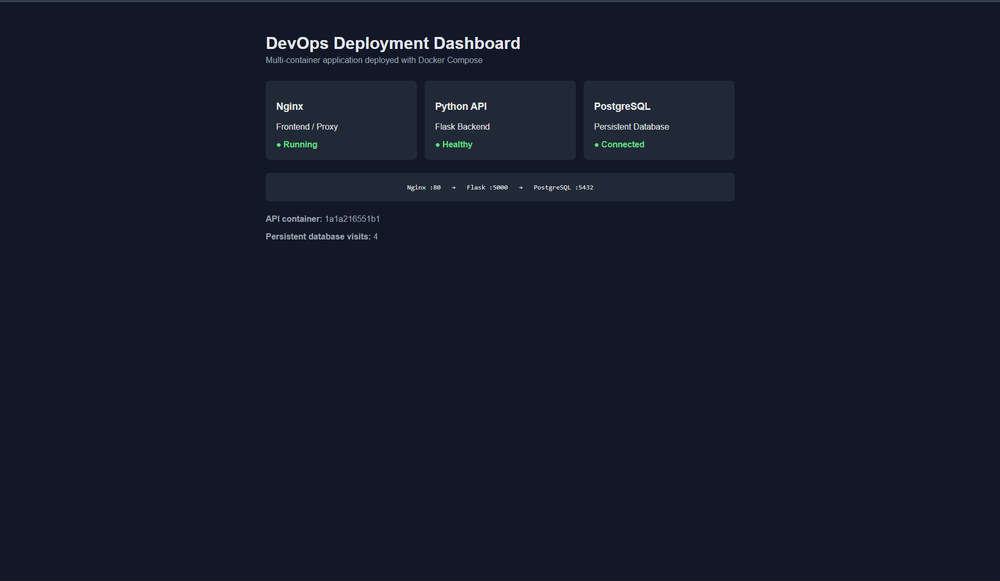
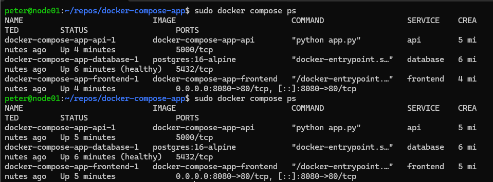
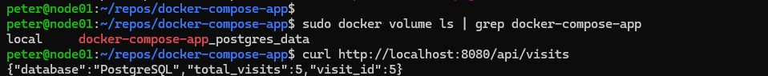

# Docker Compose Multi-Service DevOps Stack

A containerised three-tier application deployed with Docker Compose, demonstrating service orchestration, internal networking, health checks, environment-based configuration and persistent storage.

## Architecture

```text
Browser
   │
   │ :8080
   ▼
┌─────────────────┐
│      Nginx      │
│    Frontend     │
│       :80       │
└────────┬────────┘
         │
         │ Docker Compose network
         ▼
┌─────────────────┐
│  Python / Flask │
│       API       │
│      :5000      │
└────────┬────────┘
         │
         │ database:5432
         ▼
┌─────────────────┐
│   PostgreSQL    │
│    Database     │
│      :5432      │
└────────┬────────┘
         │
         ▼
  Persistent Volume
```

Only the Nginx frontend is published to the host. The API and database communicate internally through the Docker Compose network using service-name DNS.

## Technologies

- Docker
- Docker Compose
- Nginx
- Python / Flask
- PostgreSQL
- Linux
- Git

## DevOps Concepts Demonstrated

- Multi-container application orchestration with Docker Compose
- Custom Docker images using Dockerfiles
- Container-to-container networking and service-name DNS
- Nginx proxying requests to a containerised API
- PostgreSQL health checks
- Service dependency management
- Environment-variable configuration
- Named volumes for persistent database storage
- Separation of externally published and internal service ports
- Git-based project structure with secrets excluded from version control

## Application Dashboard



The dashboard verifies communication across the stack and displays the health of the Nginx frontend, Flask API and PostgreSQL database.

## Compose Services



`docker compose ps` confirms that all three services are running, including the PostgreSQL health check.

## Persistent Storage



The PostgreSQL data is stored in a named Docker volume. During testing, the application containers and Compose network were removed with `docker compose down` and recreated with `docker compose up -d`.

The stored database records remained available after container recreation, demonstrating that application data is independent of the container lifecycle.

## Run the Project

Clone the repository and create the local environment configuration:

```bash
cp .env.example .env
```

Update the development credentials in `.env`, then build and start the stack:

```bash
docker compose up -d --build
```

Check the running services:

```bash
docker compose ps
```

Open the application at:

```text
http://localhost:8080
```

Stop and remove the containers:

```bash
docker compose down
```

The PostgreSQL named volume is retained unless explicitly removed.

## API Endpoints

```text
GET /api/health
GET /api/visits
```

`/api/health` verifies API and PostgreSQL connectivity.

`/api/visits` writes a record to PostgreSQL and returns the persistent visit count.

## Repository Structure

```text
.
├── api/
│   ├── app.py
│   ├── Dockerfile
│   └── requirements.txt
├── frontend/
│   ├── Dockerfile
│   ├── index.html
│   └── nginx.conf
├── screenshots/
├── .env.example
├── .gitignore
├── compose.yaml
└── README.md
```

## Key Learning

This project demonstrates the difference between building individual containers and orchestrating a complete application stack.

Docker Compose provides a repeatable definition for the application's services, networking, dependencies, health checks and persistent storage, allowing the entire stack to be deployed consistently with a single command.
